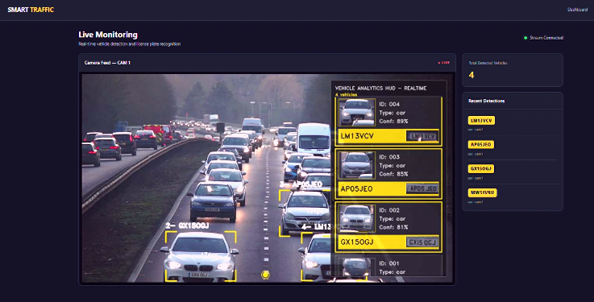
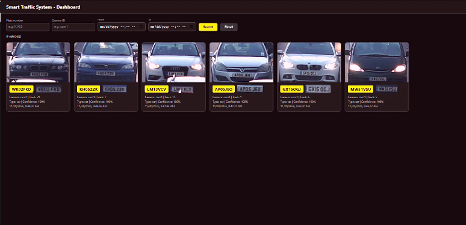

# SmartTrafficSystem

### AI-Powered Traffic Monitoring & Automatic Number Plate Recognition (ANPR)

An end-to-end traffic monitoring system that combines Computer Vision, Deep Learning, Object Tracking, and OCR to detect vehicles, track them across frames, read their license plates, and store the results in a web-based platform with live monitoring.



> **Status:** Active Development

---

## Table of Contents

- [Overview](#overview)
- [Key Features](#key-features)
- [Screenshots](#screenshots)
- [System Architecture](#system-architecture)
- [Quick Start](#quick-start)
- [Configuration](#configuration)
- [Models](#models)
- [Endpoints](#endpoints)
- [Backend API](#backend-api)
- [Project Structure](#project-structure)
- [Engineering Challenges & Solutions](#engineering-challenges--solutions)
- [Troubleshooting](#troubleshooting)
- [Known Limitations](#known-limitations)
- [Roadmap](#roadmap)
- [Tech Stack](#tech-stack)
- [Author](#author)

---

## Overview

SmartTrafficSystem automates vehicle monitoring and license plate recognition from video streams.

The Vision Engine reads frames, detects and tracks vehicles, locates each vehicle's license plate, and extracts the plate text with OCR. Once a plate is verified across multiple readings, the vehicle record and its images are sent to the backend for storage and shown on the dashboard.

The project is modular: the Vision Engine, Backend API, Database, and Frontend each run independently and communicate over HTTP.

## Key Features

- **Vehicle Detection:** cars, motorcycles, buses, and trucks with YOLOv8.
- **Multi-Object Tracking:** ByteTrack keeps a stable ID for each vehicle across frames.
- **License Plate Detection:** custom-trained YOLO model.
- **Plate Recognition:** Fast-Plate-OCR.
- **OCR Verification:** multiple readings per vehicle with confidence-based voting to reduce wrong reads.
- **Vehicle Identification:** links each confirmed plate to its tracked vehicle ID.
- **Live Video Streaming:** annotated frames streamed to the browser as MJPEG.
- **REST API:** confirmed records are sent to a FastAPI backend.
- **Storage:** vehicle data in MongoDB, vehicle and plate images on disk.
- **Web Dashboard:** vehicle records, statistics, and live monitoring.

---

## Screenshots

### Live Monitoring
Real-time processed video stream with the vehicle analytics HUD, tracking IDs, and recent detections.


### Dashboard
Searchable vehicle records with plate crop, camera, track ID, type, confidence, and timestamp. Filter by plate number, camera ID, or date range.



---

## System Architecture

| Component | Technology | Responsibility |
|---|---|---|
| Vision Engine | Python, OpenCV, YOLOv8, ONNX Runtime | Detection, tracking, plate detection, OCR |
| Backend | FastAPI | REST API and application logic |
| Database | MongoDB | Vehicle records and metadata |
| Frontend | HTML, CSS, JavaScript, Nginx | Dashboard and live monitoring |

### Processing Pipeline

```text
              Video Source
                   |
                   v
          OpenCV Frame Processing
                   |
                   v
             YOLOv8 Detection
                   |
                   v
            ByteTrack Tracking
                   |
                   v
         Vehicle Region Extraction
                   |
                   v
         License Plate Detection
                   |
                   v
             Fast-Plate-OCR
                   |
                   v
          Multi-Reading Verification
                   |
                   v
             Confirmed Vehicle
                   |
          +--------+---------+
          |                  |
          v                  v
      FastAPI API       Processed Video
          |                  |
          v                  v
       MongoDB          Live Dashboard
          |
          v
      Image Storage
```

---

## Quick Start

### Prerequisites

- Python 3.10
- Docker and Docker Compose
- Git
- Linux or WSL

### 1. Clone the repository

```bash
git clone https://github.com/AbdelRahmanHelal1/SmartTrafficSystem.git
cd SmartTrafficSystem
```

### 2. Configure environment variables

```bash
cp .env.example .env
```

Edit `.env`:

```env
MONGO_USER=your_username
MONGO_PASSWORD=your_secure_password
```

> Never commit your real `.env` file. If the password contains special characters (`@`, `:`, `/`, `#`, ...), they must be URL-encoded in the MongoDB connection URI. See [Troubleshooting](#troubleshooting).

### 3. Download the models

Place the model weights in `vision/models/`. See [Models](#models).

### 4. Start the infrastructure

```bash
docker compose up -d --build
```

This starts MongoDB, the FastAPI backend, and the frontend web server.

### 5. Run the Vision Engine

```bash
cd vision
python3.10 -m venv venv
source venv/bin/activate
pip install -r requirements.txt
python detector.py
```

The Vision Engine processes the configured video source and publishes annotated frames to the streaming server.

### 6. Open the dashboard

- Dashboard: http://localhost:5500
- Live monitoring: http://localhost:5500/live-monitoring.html

---

## Configuration

The Vision Engine is configured in `vision/detector.py`.

| Setting | Description |
|---|---|
| Video source | Path to a video file, a webcam index, or (planned) an RTSP URL |
| Vehicle model | YOLOv8 weights used for vehicle detection |
| Plate model | Custom YOLO weights used for plate detection |
| Detection resolution | Frames are resized before vehicle detection to reduce CPU load |
| Backend URL | Address the Vision Engine sends confirmed vehicles to (default `http://localhost:8000`) |
| Stream port | Port of the MJPEG streaming server (default `8001`) |

Backend and database settings come from `.env` and `backend/app/config.py`.

---

## Models

| Model | Purpose | Location |
|---|---|---|
| YOLOv8 (pretrained) | Vehicle detection | `vision/models/` |
| Custom YOLO plate detector (`best.pt`) | License plate detection | `vision/models/` |
| Fast-Plate-OCR | Plate text recognition (downloaded through the library, runs on ONNX Runtime) | managed by the library |

Model weights are large binary files, so keep them out of Git (add them to `.gitignore`) and share them through GitHub Releases or cloud storage instead.

---

## Endpoints

| Service | URL |
|---|---|
| Main Dashboard | http://localhost:5500 |
| Live Monitoring | http://localhost:5500/live-monitoring.html |
| Backend API | http://localhost:8000 |
| Swagger Docs | http://localhost:8000/docs |
| Backend Health | http://localhost:8000/health |
| Database Health | http://localhost:8000/health/db |
| Video Stream | http://localhost:8001/video_feed |

## Backend API

| Method | Endpoint | Description |
|---|---|---|
| POST | `/vehicles` | Create a vehicle record |
| POST | `/vehicles/upload` | Upload vehicle and plate images |
| GET | `/vehicles` | List vehicle records |
| GET | `/vehicles/{id}` | Get one vehicle |
| GET | `/health` | Backend status |
| GET | `/health/db` | Database connectivity |

Interactive documentation is available at `/docs`.

---

## Project Structure

```text
SmartTrafficSystem/
├── backend/
│   ├── app/
│   │   ├── api/
│   │   │   ├── health.py
│   │   │   └── vehicles.py
│   │   ├── database/
│   │   │   └── mongodb.py
│   │   ├── models/
│   │   │   └── vehicle.py
│   │   ├── services/
│   │   │   ├── storage_service.py
│   │   │   └── vehicle_service.py
│   │   ├── config.py
│   │   └── main.py
│   ├── Dockerfile
│   └── requirements.txt
│
├── frontend/
│   ├── index.html
│   ├── live-monitoring.html
│   └── Dockerfile
│
├── vision/
│   ├── models/
│   ├── detector.py
│   ├── stream_server.py
│   ├── api_client.py
│   └── requirements.txt
│
├── storage/
│   ├── vehicles/
│   └── plates/
│
├── docs/
│   └── images/
│
├── docker-compose.yml
├── .env.example
└── README.md
```

---

## Engineering Challenges & Solutions

### 1. Docker credential issue
Docker failed to pull images because of a credential configuration problem in WSL. Fixed the Docker config, verified image pulls, and rebuilt with Docker Compose.

### 2. MongoDB authentication
The backend failed at startup because special characters in the MongoDB credentials were not URL-encoded in the connection URI. The containers looked healthy while the app itself had failed. Fixed by URL-encoding the credentials and verifying with the health endpoints.

### 3. OpenCV compatibility in WSL
Hit NumPy/OpenCV version conflicts, missing system libraries, and Qt plugin errors. Solved with a dedicated virtual environment, pinned versions, and the missing Linux packages.

### 4. OCR runtime dependency
Fast-Plate-OCR failed to initialize without ONNX Runtime. Installed it in the Vision Engine environment.

### 5. Separating AI inference from the backend
A single environment for everything would cause dependency conflicts. The Vision Engine now runs in its own virtual environment, while the backend, MongoDB, and frontend run as separate containers. They communicate through HTTP.

### 6. Real-time streaming to the browser
Desktop `cv2.imshow` is not usable for a web platform. Built a FastAPI streaming server that encodes frames as JPEG and serves multipart MJPEG, always publishing the latest frame instead of stale ones.

### 7. CPU performance on 4K video
Detection, plate detection, and OCR on 4K video caused stuttering. Reduced detection resolution, ran detection on resized frames, decoupled streaming from detection, and cut unnecessary frame transmission.

---

## Troubleshooting

| Problem | Likely cause | Fix |
|---|---|---|
| Containers are running but `/health/db` fails | Special characters in the MongoDB password | URL-encode the credentials in the connection URI |
| `docker compose` cannot pull images | Docker credential helper misconfigured in WSL | Fix `~/.docker/config.json` and retry |
| Qt platform plugin error from OpenCV | Missing Qt shared libraries | Install the missing system packages, or use `opencv-python-headless` |
| NumPy / OpenCV import errors | Incompatible versions | Use a fresh venv with the pinned versions from `requirements.txt` |
| Fast-Plate-OCR fails to start | ONNX Runtime missing | `pip install onnxruntime` |
| Video stutters | CPU-only inference on high-resolution video | Lower the detection resolution or use a GPU |

---

## Known Limitations

- CPU inference is the main bottleneck in the local environment; GPU acceleration is planned for production.
- OCR can confuse visually similar characters (for example `0`/`O`, `1`/`I`, `5`/`S`).

## Roadmap

- [ ] RTSP camera integration
- [ ] GPU-accelerated inference
- [ ] Plate-format-aware OCR post-processing (fix `0`/`O`, `1`/`I`, `5`/`S` by character position)
- [ ] Multi-camera monitoring
- [ ] Advanced traffic analytics
- [ ] Vehicle search and filtering
- [ ] User authentication and access control
- [ ] Cloud deployment and production monitoring

---

## Tech Stack

**AI & Computer Vision:** Python, OpenCV, YOLOv8, ByteTrack, Fast-Plate-OCR, ONNX Runtime, NumPy

**Backend:** FastAPI, Uvicorn, PyMongo, REST APIs

**Database & Storage:** MongoDB, Docker Volumes, file-based image storage

**Frontend:** HTML5, CSS3, JavaScript, Nginx

**Infrastructure:** Docker, Docker Compose, Linux, WSL, Python virtual environments

---

## Author

**Abdelrahman Helal** — AI Engineer | Computer Vision & Generative AI

- GitHub: [AbdelRahmanHelal1](https://github.com/AbdelRahmanHelal1)
- LinkedIn: https://tinyurl.com/4hec89kr